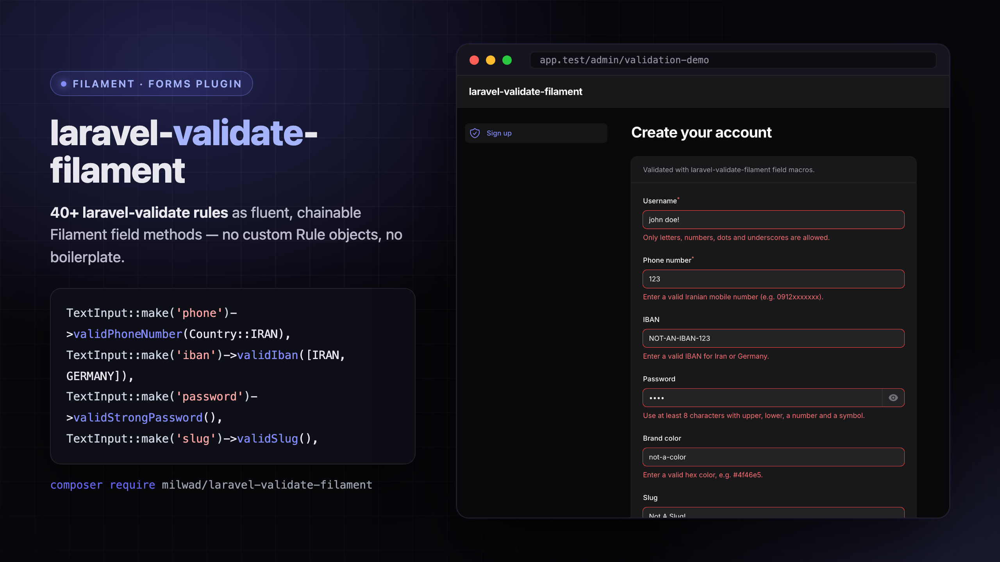

# Laravel Validate Filament



[](https://packagist.org/packages/milwad/laravel-validate-filament)
[](https://packagist.org/packages/milwad/laravel-validate-filament)
[](https://packagist.org/packages/milwad/laravel-validate-filament)
[](https://packagist.org/packages/milwad/laravel-validate-filament)
[](https://github.com/milwad-dev/laravel-validate-filament/actions/workflows/tests.yml)

> **40+ `laravel-validate` rules as fluent, chainable Filament field methods — no custom `Rule` objects, no `rule()` boilerplate.**

`laravel-validate-filament` registers a macro for every rule in [milwad/laravel-validate](https://github.com/milwad-dev/laravel-validate) on Filament's base `Field`, so you can validate phone numbers, IBANs, national cards, strong passwords, slugs, hex colors and more by chaining a single method — the same way you already chain `->required()` or `->email()`:

```php
use Filament\Forms\Components\TextInput;
use Milwad\LaravelValidate\Utils\Country;

TextInput::make('phone')->validPhoneNumber(Country::IRAN),
TextInput::make('iban')->validIban([Country::IRAN, Country::GERMANY]),
TextInput::make('color')->validHexColor(),
TextInput::make('slug')->validSlug(),
```

Without this package you would wire each rule up by hand on every field:

```php
// Before
use Milwad\LaravelValidate\Rules\ValidPhoneNumber;

TextInput::make('phone')->rule(new ValidPhoneNumber(Country::IRAN)),

// After
TextInput::make('phone')->validPhoneNumber(Country::IRAN),
```

## Contents

- [Requirements](#requirements)
- [Installation](#installation)
- [Validation messages](#validation-messages)
- [Usage](#usage)
  - [A complete form](#a-complete-form)
  - [Conditional rules](#conditional-rules)
  - [Dynamic arguments](#dynamic-arguments)
  - [Custom error messages](#custom-error-messages)
- [Available macros](#available-macros)
- [How it works](#how-it-works)
- [Troubleshooting](#troubleshooting)
- [Roadmap](#roadmap)
- [Testing](#testing)
- [Contributing](#contributing)
- [Security](#security)
- [Credits](#credits)
- [Changelog](#changelog)
- [License](#license)

## Requirements

| Package   | Versions           |
|-----------|--------------------|
| PHP       | 8.1+               |
| Laravel   | 10, 11, 12, 13     |
| Filament  | 3, 4, 5            |

## Installation

```bash
composer require milwad/laravel-validate-filament
```

The service provider is auto-discovered. It registers a macro for each rule on `Filament\Forms\Components\Field`, so the macros work on every field: `TextInput`, `Textarea`, `Select`, `DatePicker`, ...

### Validation messages

Error messages come from `milwad/laravel-validate`. Publish the language file for your locale, otherwise the raw translation key (for example `validate.hex-color`) is shown:

```bash
php artisan vendor:publish --tag="validate-lang-en"
```

Replace `en` with your language. See the [supported languages](https://github.com/milwad-dev/laravel-validate#support-languages).

## Usage

Every macro is named after its rule class (`ValidPhoneNumber` → `validPhoneNumber()`). The `valid` prefix keeps them from clashing with Filament's own methods such as `url()`, `uuid()` or `hexColor()`. Because the macros live on the base `Field` class, they chain with any field type (`TextInput`, `Textarea`, `Select`, `DatePicker`, ...) and compose freely with Filament's own methods.

### A complete form

A typical Filament resource form using several macros side by side with native Filament rules:

```php
use Filament\Forms\Components\TextInput;
use Filament\Forms\Form;
use Milwad\LaravelValidate\Utils\Country;

public function form(Form $form): Form
{
    return $form->schema([
        TextInput::make('username')
            ->required()
            ->validUsername(),

        TextInput::make('phone')
            ->required()
            ->validPhoneNumber(Country::IRAN),

        TextInput::make('iban')
            ->validIban([Country::IRAN, Country::GERMANY]),

        TextInput::make('password')
            ->password()
            ->validStrongPassword(),

        TextInput::make('website')
            ->validUrl(),

        TextInput::make('slug')
            ->validSlug(),
    ]);
}
```

### Conditional rules

Like Filament's `rule()`, every macro accepts a `$condition` as its last argument:

```php
TextInput::make('national_card')
    ->validNationalCard(condition: fn (Get $get) => $get('country') === 'IR'),
```

### Dynamic arguments

Arguments can be closures. Filament evaluates them at validation time, with its usual dependency injection:

```php
Select::make('country')
    ->options(['IR' => 'Iran', 'DE' => 'Germany'])
    ->live(),

TextInput::make('phone')
    ->validPhoneNumber(fn (Get $get) => $get('country')),
```

### Custom error messages

Error messages come from the `milwad/laravel-validate` rule classes. To change the wording, publish that package's language file and edit the relevant key (see [Validation messages](#validation-messages)):

```bash
php artisan vendor:publish --tag="validate-lang-en"
```

```php
// lang/vendor/validate/en/validate.php
'hex-color' => 'The :attribute must be a valid hex color (e.g. #fcba03).',
```

Edits there apply everywhere the rule is used, in Filament forms and in ordinary Laravel validation alike.

## Available macros

| Macro                          | Arguments                              | Rule                         |
|--------------------------------|----------------------------------------|------------------------------|
| `validBase64()`                |                                        | `ValidBase64`                |
| `validBitcoinAddress()`        |                                        | `ValidBitcoinAddress`        |
| `validCamelCase()`             |                                        | `ValidCamelCase`             |
| `validCapitalCharWithNumber()` |                                        | `ValidCapitalCharWithNumber` |
| `validCarNumber()`             |                                        | `ValidCarNumber`             |
| `validCartNumberIran()`        |                                        | `ValidCartNumberIran`        |
| `validCountry()`               | `bool $validByKey = false`             | `ValidCountry`               |
| `validCreditCard()`            |                                        | `ValidCreditCard`            |
| `validDiscordUsername()`       |                                        | `ValidDiscordUsername`       |
| `validDomain()`                |                                        | `ValidDomain`                |
| `validDuplicate()`             |                                        | `ValidDuplicate`             |
| `validDuplicateCharacter()`    |                                        | `ValidDuplicateCharacter`    |
| `validEvenNumber()`            |                                        | `ValidEvenNumber`            |
| `validHashtag()`               |                                        | `ValidHashtag`               |
| `validHexColor()`              |                                        | `ValidHexColor`              |
| `validHtmlTag()`               |                                        | `ValidHtmlTag`               |
| `validIban()`                  | `array\|string $countries = []`        | `ValidIban`                  |
| `validImei()`                  |                                        | `ValidImei`                  |
| `validIpAddressIPV4()`         |                                        | `ValidIpAddressIPV4`         |
| `validIpAddressIPV6()`         |                                        | `ValidIpAddressIPV6`         |
| `validIranPostalCode()`        |                                        | `ValidIranPostalCode`        |
| `validJalaliDate()`            | `string $character = '/'`              | `ValidJalaliDate`            |
| `validJwt()`                   |                                        | `ValidJwt`                   |
| `validKebabCase()`             |                                        | `ValidKebabCase`             |
| `validLandlineNumber()`        | `?string $code = null`                 | `ValidLandlineNumber`        |
| `validLatitude()`              |                                        | `ValidLatitude`              |
| `validLongitude()`             |                                        | `ValidLongitude`             |
| `validNameDaysWeek()`          |                                        | `ValidNameDaysWeek`          |
| `validNationalCard()`          |                                        | `ValidNationalCard`          |
| `validNoHtml()`                | `bool $strict = false`                 | `ValidNoHtml`                |
| `validOddNumber()`             |                                        | `ValidOddNumber`             |
| `validPascalCase()`            |                                        | `ValidPascalCase`            |
| `validPattern()`               | `int $length, string $separator = '-'` | `ValidPattern`               |
| `validPhoneNumber()`           | `?string $code = null`                 | `ValidPhoneNumber`           |
| `validPort()`                  |                                        | `ValidPort`                  |
| `validSlashEndOfString()`      |                                        | `ValidSlashEndOfString`      |
| `validSlug()`                  |                                        | `ValidSlug`                  |
| `validSnakeCase()`             |                                        | `ValidSnakeCase`             |
| `validStrongPassword()`        |                                        | `ValidStrongPassword`        |
| `validUlid()`                  |                                        | `ValidUlid`                  |
| `validUrl()`                   |                                        | `ValidUrl`                   |
| `validUsername()`              |                                        | `ValidUsername`              |
| `validUuid()`                  |                                        | `ValidUuid`                  |
| `validVatId()`                 |                                        | `ValidVatId`                 |

Every macro also takes `bool|Closure $condition = true` as its last argument. Country codes are available as constants on `Milwad\LaravelValidate\Utils\Country`. For details on each rule, see the [laravel-validate docs](https://github.com/milwad-dev/laravel-validate).

## How it works

On boot, the package's service provider calls `FieldMacros::register()`, which loops over every `laravel-validate` rule and registers a [macro](https://laravel.com/docs/packages#macros) on `Filament\Forms\Components\Field`. Each macro simply forwards to Filament's `rule()` method with a fresh rule instance, so there is no runtime overhead beyond the rules you actually use, and nothing to configure. Rules that take constructor arguments (`validIban`, `validPhoneNumber`, ...) accept those arguments — and closures in their place — and resolve them with Filament's `evaluate()` at validation time.

## Troubleshooting

**A macro method is not found (`Method ... does not exist`).** Make sure the package is installed and its service provider is discovered (`composer require milwad/laravel-validate-filament`, then `php artisan package:discover` if you have disabled auto-discovery). The macros are only registered once the service provider boots.

**The error message shows a raw key like `validate.hex-color`.** Publish the `milwad/laravel-validate` language file for your locale so the key resolves to real text — see [Validation messages](#validation-messages) and [Custom error messages](#custom-error-messages). The wording lives in the rule's translation file, not in Filament's per-field `validationMessages()`, so edit it there.

**Validation does not run on an empty field.** Like Laravel's own rules, these run only when a value is present. Chain `->required()` when the field must not be empty.

## Roadmap

v1 ships field macros only. Planned for next versions:

- [ ] Ready-made field components for the most common rules, e.g. `PhoneNumberInput::make('phone')`, `IbanInput::make('iban')`, `NationalCardInput::make('national_card')`, `StrongPasswordInput::make('password')`, each with the rule applied plus sensible defaults (mask, placeholder, prefix icon, input mode).
- [ ] Translated error messages out of the box, without having to publish the `milwad/laravel-validate` language files.
- [ ] IDE autocompletion for the macros (stub file with `@method` annotations, or a `php artisan laravel-validate-filament:ide-helper` command).
- [ ] Optional table column / infolist helpers (e.g. masked IBAN / card number display).
- [ ] Keep the macro list in sync when `milwad/laravel-validate` adds new rules.

## Testing

```bash
composer test
```

The suite runs against the Laravel and Filament versions listed in [Requirements](#requirements) via [Orchestra Testbench](https://github.com/orchestral/testbench). If you are contributing a change, install dev dependencies first:

```bash
composer install
composer test
```

## Contributing

Contributions are welcome. A good change is small, focused, and comes with a test.

1. Fork the repository and create a branch off `1.x`.
2. Run `composer install`.
3. Make your change. New or changed behaviour needs a passing test under `tests/`.
4. Run `composer test` and make sure the suite is green.
5. Open a pull request describing what changed and why.

If you are adding support for a new `milwad/laravel-validate` rule, register its macro in [`src/FieldMacros.php`](src/FieldMacros.php) — a no-argument rule goes in the `SIMPLE_RULES` list, a rule with constructor arguments gets its own `Field::macro()` in `registerRulesWithArguments()` — and add a row to the [Available macros](#available-macros) table.

## Security

If you discover a security vulnerability, please do **not** open a public issue. Email the author at [milwad.dev@gmail.com](mailto:milwad.dev@gmail.com) instead. All reports will be reviewed and addressed promptly.

## Credits

- [Milwad Khosravi](https://github.com/milwad-dev) — author
- [milwad/laravel-validate](https://github.com/milwad-dev/laravel-validate) — the validation rules this package exposes
- [All contributors](https://github.com/milwad-dev/laravel-validate-filament/graphs/contributors)

## Changelog

See the [Releases page](https://github.com/milwad-dev/laravel-validate-filament/releases) for the list of changes in each version.

## License

The MIT License (MIT). See [LICENSE](LICENSE).
